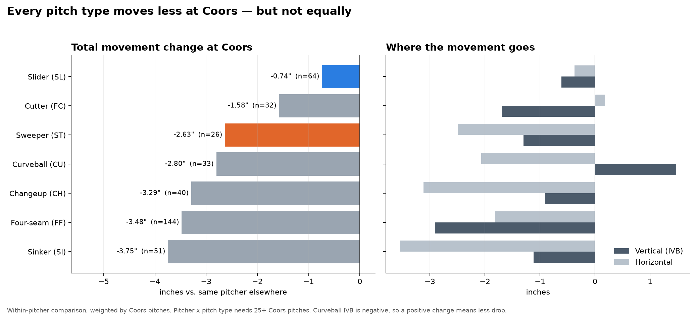

# Who Keeps Their Stuff at Coors?

Projecting which MLB pitchers hold their movement at Coors Field, including pitchers who have never pitched there.

**Live app:** [coors-pitchers.streamlit.app](https://coors-pitchers.streamlit.app)



## Key findings

- **Every pitch loses movement at Coors, but not equally.** Comparing each pitcher with himself, tight sliders lose about 0.7 inches of movement, sweepers 2.6, and four-seam fastballs 3.5.
- **Spin-driven pitches lose the most.** Within a pitch type, pitches that get more movement per 1,000 rpm, and higher-spin versions, lose the most (both p < 0.001). Thin air weakens the force that turns spin into movement.
- **Rockies pitchers don't adapt as a group.** On four-seamers and sinkers, Rockies pitchers and visitors lose almost the same movement. What matters is the individual arsenal.
- **The effect can be projected.** Pitch type explains most of it (R² 0.64). Adding pitcher traits improves out-of-sample predictions by about 5% (R² 0.67), validated on pitchers the model never saw.

## The Coors score

Every 2026 pitcher gets a Coors score: the projected inches of movement his arsenal keeps at Coors compared with the average pitcher, weighted by how often he throws each pitch. The score splits into:

- **Mix:** what his pitch selection implies (slider-heavy pitchers start ahead)
- **Stuff:** how his versions of those pitches compare with typical ones

For pitchers with Coors history, projections blend the model with actual results, trusting actual results more as the sample grows.

## Data and methods

- Every regular-season pitch from 2025 and 2026 (about 710,000 per season), from Statcast via [pybaseball](https://github.com/jldbc/pybaseball)
- Stored in DuckDB and aggregated with SQL
- Within-pitcher comparisons: the same pitch type at Coors vs. elsewhere
- Weighted regression with pitch-type baselines (statsmodels, scikit-learn), 5-fold cross-validation grouped by pitcher
- 2026 ERA and innings from the MLB Stats API
- Interactive app built with Streamlit

## Limitations

- Movement is not run prevention. Coors also inflates offense through its large outfield and batted-ball carry.
- Most visiting pitchers throw at Coors once or twice a year, so per-pitcher samples are small.
- Weather and the humidor are not controlled for.
- Starters are pitchers who threw their team's first pitch in at least half their games, so openers count as starters.

## Files

| File | What it does |
| --- | --- |
| `pull_statcast.py` | Downloads Statcast data week by week and builds the DuckDB database |
| `part1_coors_effect.py` | Measures movement change at Coors by pitch type and pitcher |
| `part2_predict_resilience.py` | Tests what predicts movement loss and projects it for every pitch |
| `part3_score_pitchers.py` | Combines projections into one Coors score per pitcher |
| `app.py` | The Streamlit app |
| `output/` | Charts and result tables |
| `app_data/` | Small data files the app reads |

## Run it yourself

```
pip install pybaseball duckdb pandas pyarrow matplotlib scikit-learn statsmodels streamlit
python pull_statcast.py
python part1_coors_effect.py
python part2_predict_resilience.py
python part3_score_pitchers.py
streamlit run app.py
```

The data download takes a while; if it stops, run it again and it picks up where it left off.

---

Built by RJ Johnson, with Claude as a coding assistant.
